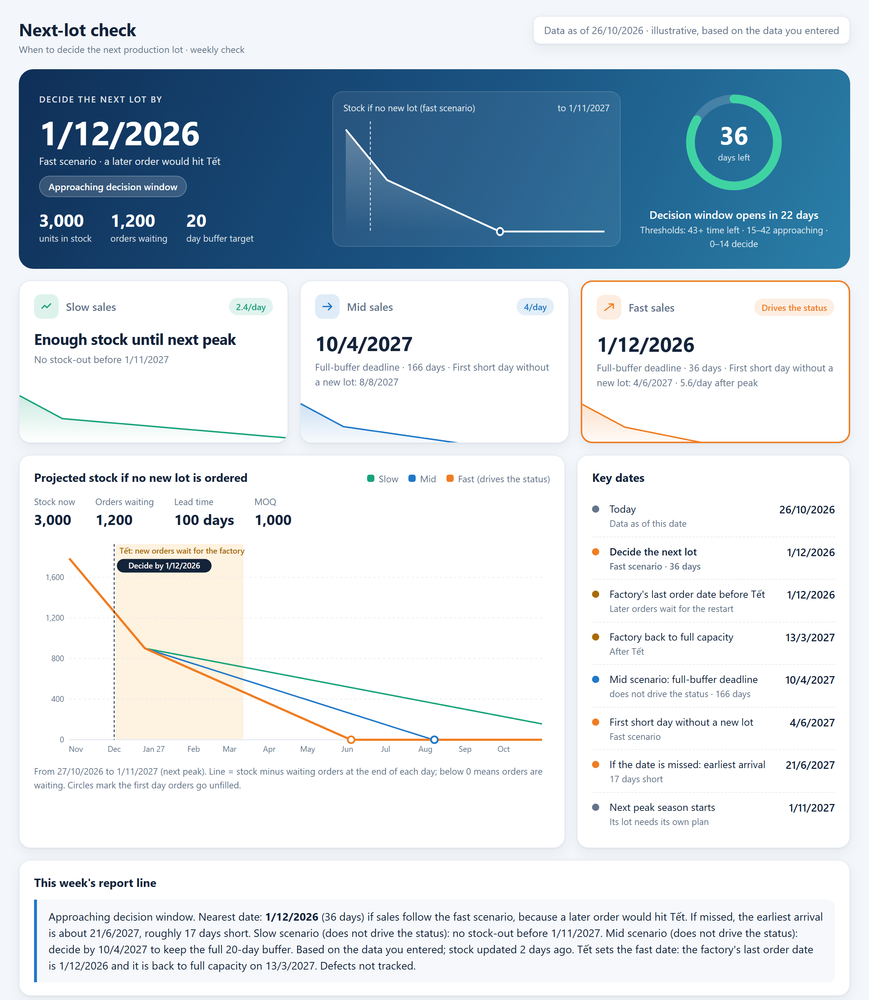

# next-lot-signal

A small Claude Code skill that tells you when to decide your next production lot.



## What it tells you

- **The latest date to decide the next lot** while still keeping your safety buffer.
- **Whether the factory's cut-off before Lunar New Year (Tết / CNY)** pulls that date earlier.
- **How many days you would be out of stock** if that date is missed.

Each run also saves a one-page dashboard next to your data. You can point at its chart to read any day, highlight a scenario, and switch between a light and a dark background. Shown as an artifact in Claude, it also has a box where you can ask Claude about the numbers: Claude explains them, and a "what if" needs a new run of the skill, so the skill stays the only place that calculates.

## What you need

- Claude Code (in a terminal) or the Claude desktop app.
- Two exports from your Shopify store: Orders and Inventory.
- A few numbers from your factory and freight forwarder, such as lead times and the factory's Tết dates. If you don't know one yet, Claude tells you where to find it.

## Install

**In Claude Code in a terminal**, type:

```
/plugin install next-lot-signal --marketplace Namanhtranduc/next-lot-signal
```

Then start a new session. To use the skill, type `/next-lot-signal:next-lot-signal`.

**In the Claude desktop app**, ask Claude:

```
Copy the skills/next-lot-signal folder from github.com/Namanhtranduc/next-lot-signal into ~/.claude/skills/
```

Then start a new session. To use the skill, type `/next-lot-signal`.

A new session is needed because Claude reads its list of skills when a session starts.

<details>
<summary>Other ways to install</summary>

- **From a shell, without opening a session:** `claude plugin install next-lot-signal --marketplace Namanhtranduc/next-lot-signal`
- **On an older Claude Code:** `/plugin marketplace add Namanhtranduc/next-lot-signal`, then `/plugin install next-lot-signal@next-lot-signal`.
- Plugins installed from a terminal also show up in the desktop app.

</details>

## Try it on the sample (about 5 minutes)

The skill comes with [sample data](skills/next-lot-signal/sample/) (made-up numbers). Type your skill command followed by `sample`, for example:

```
/next-lot-signal:next-lot-signal sample
```

You get a short report, and Claude asks whether to show the dashboard as a private artifact in Claude. Where Claude cannot make artifacts, it offers to open the dashboard in your web browser instead. You can also skip the command and ask in plain words: "when do we need to decide the next production lot?"

**How each sample number was chosen:** [ASSUMPTIONS.md](skills/next-lot-signal/sample/ASSUMPTIONS.md).

## Use it on your own data

1. **Export from Shopify:** Orders (*Orders → Export*), covering the last 14 days and every unfulfilled order, and Inventory (*Products → Inventory → Export*). Put both files in one folder, for example `next-lot/`.
2. **Run the skill on that folder:** type your skill command followed by the folder, for example `/next-lot-signal:next-lot-signal next-lot/`.
3. **Answer Claude's questions.** Claude finds the two exports, asks which product to plan if there are several, and asks in one message for the settings it still needs.
   - Each question comes with a hint on where to find the answer.
   - If you don't know a number, Claude can suggest a starting value. It uses the value only after you confirm it.
   - It never guesses a setting silently; a missing one is named in the report.
4. **Read the report and the dashboard.** Your answers are saved in `config.md` in that folder, so you won't be asked again. So is the dashboard's artifact link, so each week updates the same link.

**Language:** the skill answers in English. Write to it in Vietnamese and it answers in Vietnamese.

## Each week

Replace the two exports and run it again. To add a lot already on order, just say, for example, "a lot of 2,000 units arrives on 15/3/2027".

## What it does not do

- It never places orders or contacts suppliers; a person decides.
- It covers the next lot until the next peak season starts. The peak-season lot needs its own plan.
- One product, one stock location.
- It currently reads Shopify exports only.

The full rules, in plain English, are in [`skills/next-lot-signal/references/rules.md`](skills/next-lot-signal/references/rules.md).

## Limitations

What this skill does not do well yet:

| # | Limitation | What it means in practice |
|---|---|---|
| L1 | **Its inputs are carried in by hand.** Factory closure dates, lead times, lots on the way, the date promised to pre-order customers and defect data are all typed in. | If one of them is out of date, the deadline is wrong and nothing flags it. |
| L2 | **One lead time for the whole factory.** | It cannot see that one slow part, such as a circuit board, sets the deadline on its own. |
| L3 | **The after-peak sales rate is a guess, and the slow/fast range is fixed at ±40%.** | The range does not narrow as real sales come in. After 28 days of real sales it only proposes a new rate, for a person to approve. |
| L4 | **It answers "when", not "how many" or "how much cash".** | Units needed is a rough count, with no unit cost, deposit or payment dates. |
| L5 | **A missed date gives a shortage count, not a way out.** | It says "17 days short", but not what air freight would save or cost. |
| L6 | **It works from weekly exports, and it is one more report to read.** | The picture can be up to a week old, and it sits apart from the team's other updates. |
| L7 | **It has not run on real data yet.** | It passed 8 made-up test cases and one realistic Shopify export, not a full lot cycle in a real business. |

## License

MIT
